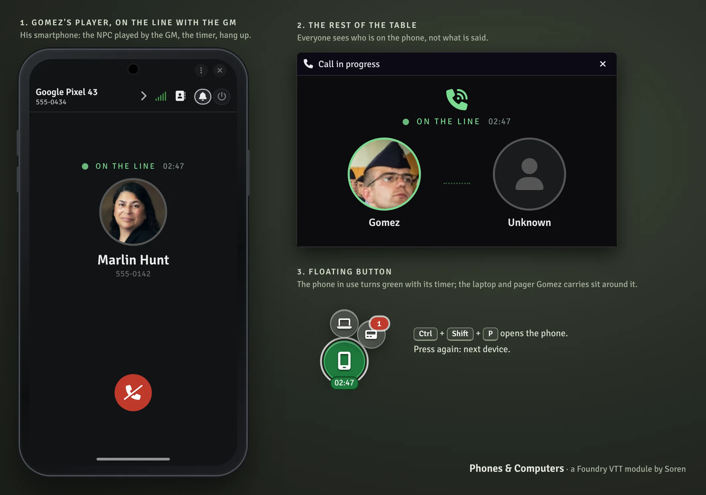
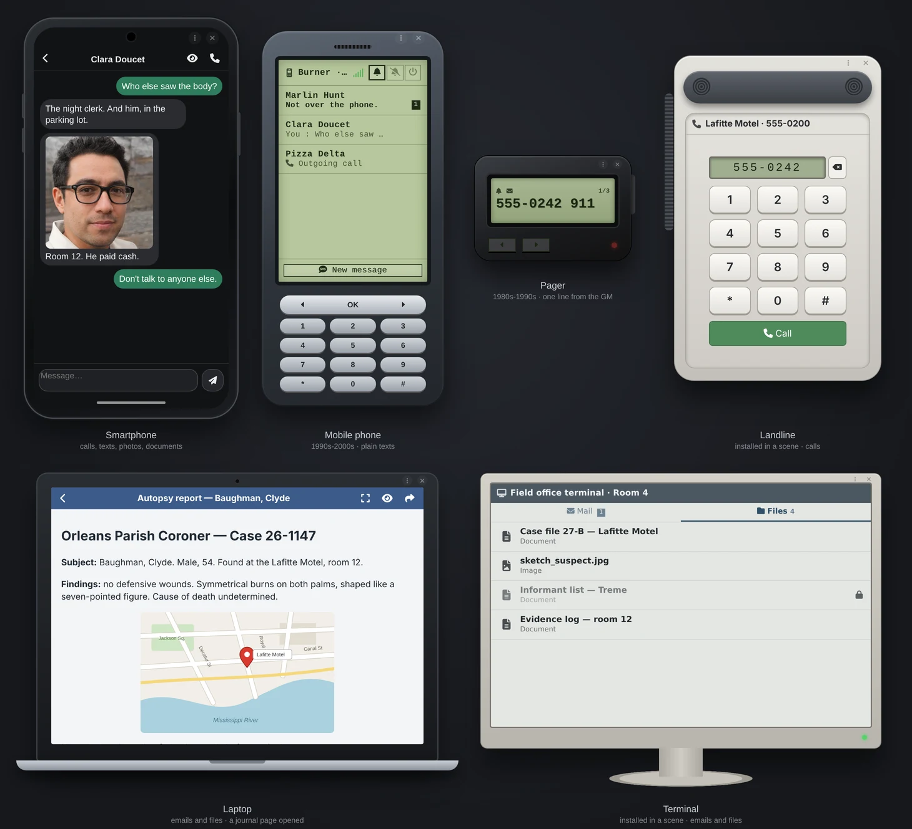
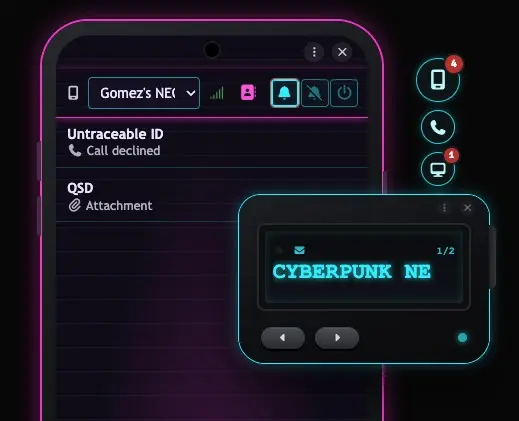
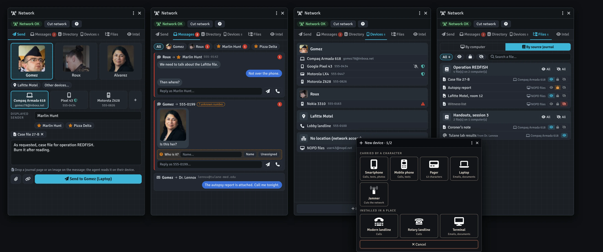

🇫🇷 [Version française](README.fr.md)

# Phones & Computers

*For modern or sci-fi settings: Delta Green, Cthulhu, Vampire, Blade Runner, Cyberpunk…*

A <a href="https://foundryvtt.com" target="_blank">Foundry VTT</a> module that gives your characters phones, laptops and room terminals. Every call or message to an NPC lands with the GM, who answers, lets it ring, or decides the number doesn't exist. Built for investigation and narrative play, not as a smartphone simulator.

- **Ctrl+Shift+P** opens the GM panel, or the player's phone (multiple presses). Floating buttons too.
- **No setup needed:** the GM can ring a player or text them right away; a phone is created for their character if needed.
- **Agents talk to each other** directly. Nothing ever goes to the chat.
- Any game system. English and French.



> **The GM must be connected.** The GM's browser acts as the network. Without a GM online, players can read their messages but cannot write or call.

---

## Ideas for your table

- **A contact who calls back**, or never does.
- **A stolen phone.** Lock it, unlock it when the roll succeeds, hand it to another character with its whole history.
- **A prepared clue.** Write a device's history in advance: messages, photos, missed calls.
- **A terminal in a room**, read by whoever stands there.
- **A remote case file.** A terminal shared with several players, reachable from anywhere, its sensitive files locked until the agents find the password.
- **Show, don't tell.** A player shows their screen to the agents in the same room, or forwards the photo.
- **A ready-to-play scenario.** `@SMS` and `@Call` links in a journal send a message or ring a phone in one click.

---

## Installation

In Foundry: **Add-on Modules → Install Module**, then paste the manifest URL:

```
https://github.com/Dispositif/foundry-phones-computers/releases/latest/download/module.json
```

**Upgrading from Phone & Terminal (v0.29 and earlier):** install this module, enable it instead of the old one and reload. Devices, histories and settings are moved over automatically.

---

## Devices

A device is an item carried by a character, or installed in a place (a scene) and used by whoever stands there. Create one from the GM panel.



- **Universe** (world setting): Vintage, Modern or Cyberpunk.
- **Files** (laptop, terminal): drop journal pages or images on the device. Players read them inside the screen, without access to your Foundry journals. Lock or hide each file.
- **Shared devices:** give a device from the Items sidebar to several players. A terminal with no location becomes a database they reach from anywhere.
- **Give to…** passes a device to another character with its number, contacts and history.
- **Public devices:** other PCs find them by name on their phones.
- **Advanced features** (GM panel settings): secure devices, jammer, satellite phones and links, compromised devices, tracking.



---

## Features for players

- Conversations by correspondent, replies, calls, contact book.
- **Show the screen** to the agents in the same room, or **forward** a message over the network.
- **The whole table sees the call:** the agents' portraits, "Calling…", then who is on the line with a timer.

---

## GM side



The **Network** panel (Ctrl+Shift+P, or the telecom button).

- **Send:** pick an agent, then one of their devices (or a place's landline), and ring it or text it under any identity (NPC, number, hidden number), with an image or a journal page attached. An agent without a device gets one in a click.
- **Messages:** the agents' messages to NPCs, unread first, with a text or email icon. Reply as the NPC; name an unknown number or mark it unassigned in one click.
- **Directory:** your NPCs and their numbers (optional, see below).
- **Devices:** every device by holder or place. Lock, no signal, give, edit, prepare its history; make it public or a favorite (★) sender.
- **Files:** every computer file, by computer or by source journal: visible, locked or hidden.
- **Intel:** wiretaps (the agents' messages to each other, read only), every call with its outcome and duration, and tracking (experimental, how precisely the network can locate each agent).
- When an agent calls an NPC, you choose: answer, no answer, unreachable, unassigned (not in service).
- **Cut network** for the whole mobile network, or **cut the line** of any call in progress.
- A device with no signal or switched off gets nothing: messages and missed calls wait, and arrive when the signal returns or the device is switched back on.
- The **?** button opens the GM welcome window and a guided tour of the panel. The **GM panel theme** setting picks its look (Ops room, Orange haze, Classic, or Auto by universe).

**NPC directory (optional):** you can text or call under any name, and any number an agent dials reaches you, so there is nothing to set up. The Directory tab only helps you keep track of NPC numbers: name a number, make it public (pizzeria, taxi, hospital: yellow pages for the players), make it a favorite (★) sender in Send and Messages, or put it out of service (calls and texts get "not in service"). Import / export as text, for instance from your notes.

**Journal links:** `@SMS[recipient|sender]{text}` and `@Call[recipient|sender]` (also `@Mail`, `@SecureSMS`, `@SecureMail`, `@SecureCall`) become buttons in your scenario notes. The panel's link button writes them for you. Players see only the text.

---

## For developers

Each device is an ordinary Foundry item carrying one flag, `flags["soren-phones-computers"].phone`. History, contacts and files live there, so the item can be duplicated, moved or put in a compendium with its data. A burner mobile, for instance:

```json
{
  "model": "mobile", "label": "Burner", "number": "555-0177", "theme": "default",
  "mode": "on", "locked": false, "compromised": false, "noSignal": false, "sceneId": null,
  "contacts": [{ "name": "Marlin Hunt", "number": "555-0242" }],
  "log": [
    { "id": "k3Fq9aZ1", "t": 1762981200000, "kind": "sms", "dir": "in", "with": "555-0242", "text": "Not over the phone.", "read": false },
    { "id": "pL8wX2cD", "t": 1762980900000, "kind": "call", "call": "c7Hn2", "dir": "out", "with": "555-0242", "result": "answer", "dur": 74 }
  ]
}
```

- `model`: smartphone, mobile, brick, satphone, pager, computer (laptop), desktop (terminal), landline, jammer. Laptops and terminals add `files` and `inbox`.
- `log` is newest first, 200 entries max (GM-prepared ones, `prep: true`, are always kept). `t` only orders entries; it is never shown.
- `with` is the other end's number: names come from contacts or the NPC directory when displayed.
- Attachments and files hold a reference (`uuid` for a journal page, `src` for an image), not the content.
- World settings hold the rest: NPC directory, number prefix, network cut, calls in progress.

**The GM's browser is the network.** Players never write to devices directly: every message, call and read receipt goes through the module socket to the active GM, who checks and writes. Journal content shown on a device is rendered by the GM and sent as HTML, so players need no journal permission.

---

© 2026 Soren, all rights reserved. Icons and sounds: authors and licenses in [CREDITS.md](CREDITS.md).

[Foundry v13-v14](https://img.shields.io/badge/foundry-v13--v14-blue?style=for-the-badge)
[Downloads](https://img.shields.io/github/downloads/Dispositif/foundry-phones-computers/total.svg?style=for-the-badge)
[Current version](https://img.shields.io/github/v/release/Dispositif/foundry-phones-computers?display_name=tag&style=for-the-badge&label=Current%20version)
